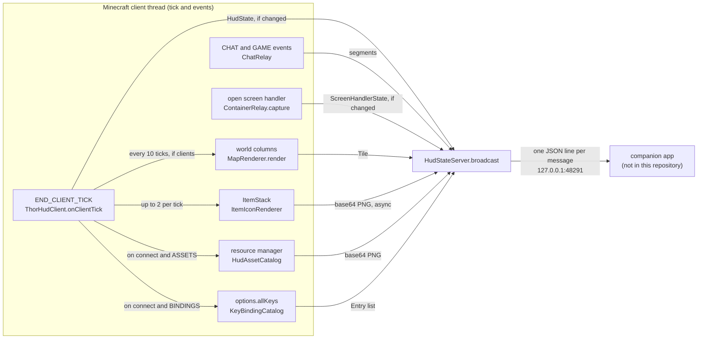
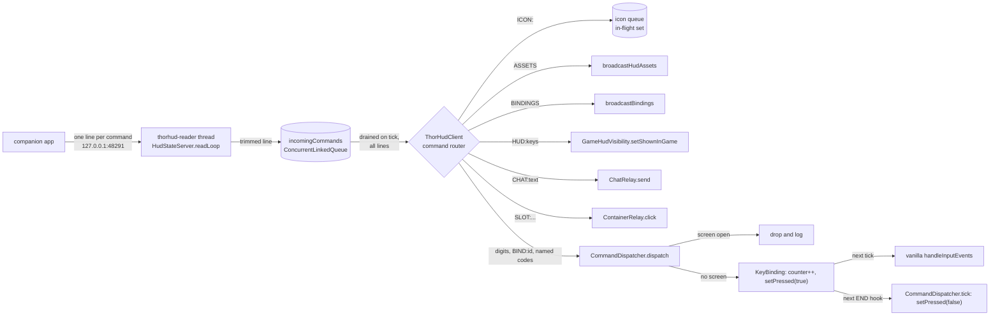
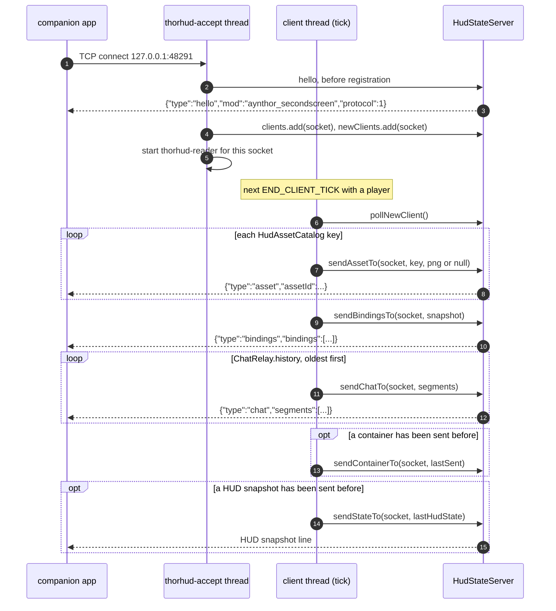
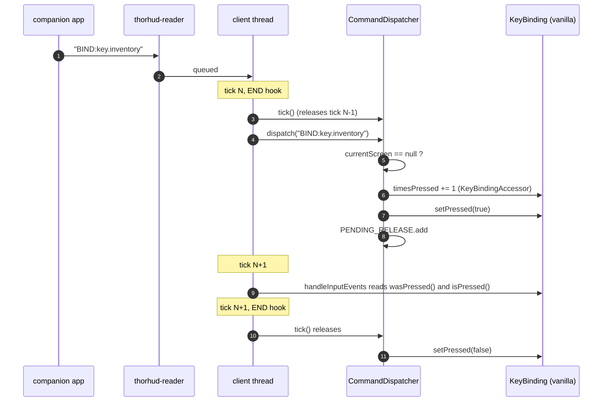
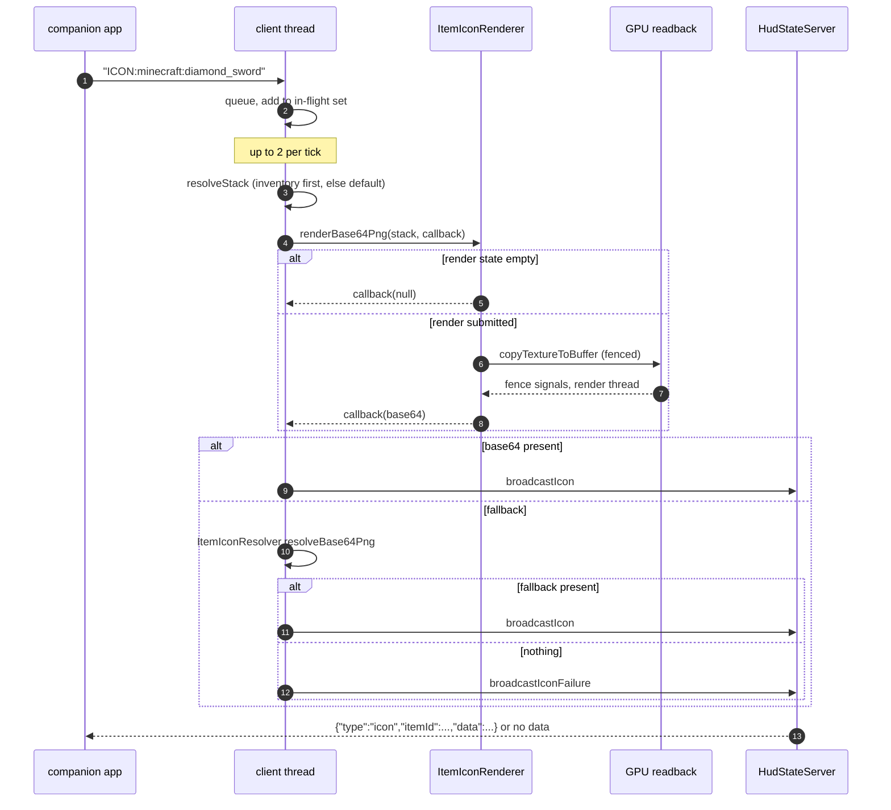
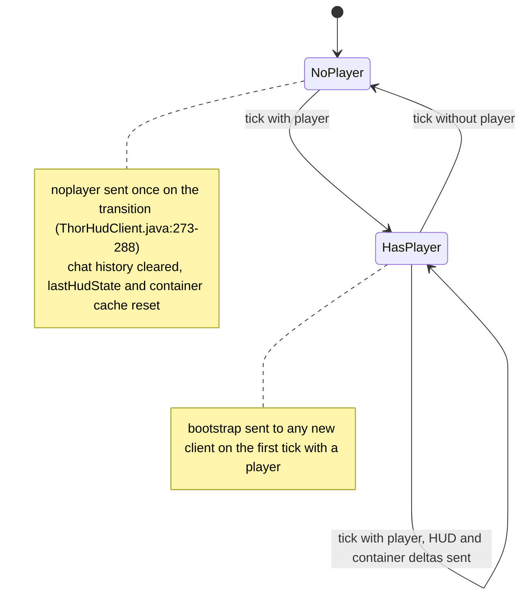
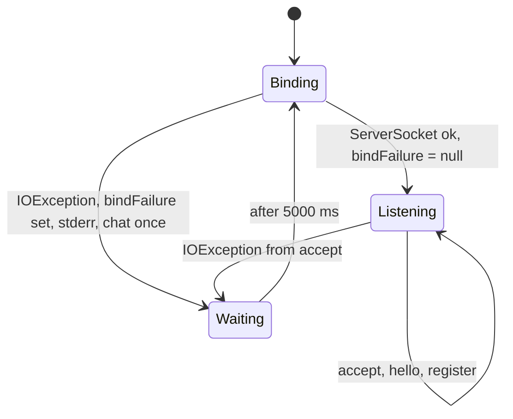

# 03 - Data flow

Mermaid diagrams for the paths data takes through the mod. Each diagram names the classes it refers to, so it can be
checked against the module map in [01-architecture-modules.md](01-architecture-modules.md). The Fabric path is the
primary one. Differences on Forge are noted under each diagram.

## 1. Outbound: game state to the app

Forge differences: the icon path is `ItemIconResolverForge` (texture file only, no `ItemIconRenderer`), there is no
asset path, and `MapRendererForge` uses `ImageIO` and is otherwise the same. Container state comes from
`ContainerRelayForge.capture`, which adds widgets and the title.

## 2. Inbound: app to game

Forge differences: the router is `ThorHudForgeClient.onClientTick` and adds `WIDGET:`, `SCREEN_CLICK:`, `SORT`,
`CLOSE_CONTAINER` and `SUPPRESS_CONTAINER:`. `ASSETS` is accepted and does nothing. Presses go through
`CommandDispatcherForge`, which uses `KeyMapping.click` and `setDown`.

## 3. Bootstrap on connect (Fabric)

Notes on the diagram:

- A broadcast from the tick thread can reach the socket between steps 2 and 3, because the socket is registered before
  the bootstrap runs (`HudStateServer.java:92-97`). See [02-algorithms-timing.md](02-algorithms-timing.md) section 5.
- On Forge the order is bindings, chat, the last snapshot (sent with `broadcast`, so to every client), then the container.
  No assets are sent (`ThorHudForgeClient.java:215-230`).
- Nothing in this sequence happens before a player exists (`ThorHudClient.java:142-146`).

## 4. Key press, end to end

If a screen is open at dispatch time, the press is dropped with a log line and nothing is queued
(`CommandDispatcher.java:140-143`).

## 5. Icon request

The callback runs on the render thread after the GPU fence, not on the tick that started the render
(`ItemIconRenderer.java:278-289`). The id stays in the in-flight set until the callback removes it.

## 6. Leaving and re-entering a world

## 7. Bind and retry

The chat line is posted by the tick thread, not by the accept thread (`ThorHudClient.java:244-259`). The flag that stops
repeats is cleared when the bind succeeds.
